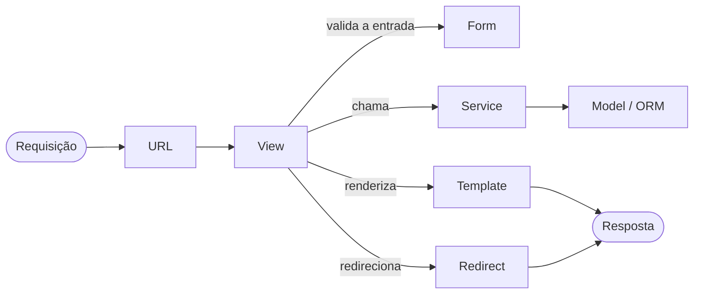

# Arquitetura

O projeto **SemBarreiras** segue o padrão MVT do Django, com todas as regras de negócio concentradas na camada de service. O motivo dessa decisão está na [ADR 0001](adr/0001-mvt-com-camada-de-service.md).

## Fluxo de uma requisição



## Divisão em Apps

O sistema é organizado em apps por domínio funcional:

- `contas`: autenticação, cadastro de usuário PCD e cuidador, vínculo por código OTP, recuperação de senha e preferências de acessibilidade motora ([ADR 0002](adr/0002-modelo-de-usuario-e-perfis-de-acesso.md)).
- `emergencia`: contatos prioritários de emergência, acionamento do botão de pânico, janela de cancelamento e histórico de ocorrências.
- `transporte`: consulta de linhas de ônibus acessíveis, rastreamento simulado em tempo real e cálculo de tempo estimado de chegada (ETA) ([ADR 0004](adr/0004-simulacao-local-de-integracoes-externas.md)).
- `agendamentos`: marcação, remarcação e cancelamento de consultas/reabilitação na ADEFAL, solicitação de transporte hospitalar adaptado (van) e emissão de comprovante digital com QR Code assinado.
- `equipamentos`: requisição de empréstimo de equipamentos de apoio, upload e validação segura de laudos médicos ([ADR 0005](adr/0005-armazenamento-e-validacao-de-anexos.md)), linha do tempo de acompanhamento e alertas/renovação de prazo.

## Views (`<app>/views/`)

- Toda view é uma classe que herda diretamente de `django.views.View`.
- Implemente apenas os métodos HTTP necessários (`get`, `post`).
- Mixins de controle de acesso, como `LoginRequiredMixin`, são permitidos.
- Não use views baseadas em função nem generic views (`ListView`, `CreateView` etc.).
- A view só recebe a requisição, valida o formato via Form, chama o service e retorna a resposta (template, arquivo ou redirect).
- A view não contém regra de negócio nem acessa o ORM diretamente. Por isso, não usa `get_object_or_404`.
- `login()` e `logout()` são chamados na view, pois alteram a sessão HTTP e precisam de `request` ([ADR 0002](adr/0002-modelo-de-usuario-e-perfis-de-acesso.md)).

## Forms (`<app>/forms/`)

- Validam o formato da entrada (máscaras, tamanhos, tipos de arquivo) e renderizam os campos.
- A gravação é feita pelo service, sem `form.save()`.

## Services (`<app>/services/`)

- Toda regra de negócio fica aqui, incluindo validações de domínio, verificações de permissão sobre objetos (titular PCD ou cuidador com vínculo ativo), integrações simuladas e consultas ao ORM.
- Services não recebem `request` nem retornam `HttpResponse`.
- Falhas são comunicadas por exceções de domínio (`<app>/exceptions.py`), que a view converte em respostas HTTP ou mensagens de erro.

## Models (`<app>/models/`)

- Definem campos, relacionamentos, constraints, índices e metadados, sem regra de negócio.

## Templates

- Cuidam apenas da apresentação, sem lógica de negócio.
- Aplicam as classes de acessibilidade motora (tamanho de área de toque, alto contraste e tempo de sessão) definidas no perfil do usuário.

## Admin

- O Admin não deve ignorar as regras dos services: suas ações (como triagem de equipamentos, gestão de vagas da ADEFAL e frota) chamam os services, e a escrita direta fica bloqueada nos models cujas invariantes dependem deles.

## Exemplos

Leitura:

```python
class ConsultaListView(LoginRequiredMixin, View):
    def get(self, request):
        consultas = AgendamentoService.listar_do_paciente(request.user)
        return render(request, "agendamentos/lista.html", {"consultas": consultas})
```

Alteração, com a exceção de domínio convertida em resposta HTTP:

```python
class ConsultaCancelarView(LoginRequiredMixin, View):
    def post(self, request, protocolo):
        try:
            AgendamentoService.cancelar(protocolo=protocolo, solicitante=request.user)
        except AgendamentoNaoEncontrado as exc:
            raise Http404 from exc
        except PrazoCancelamentoExpirado as exc:
            messages.error(request, str(exc))
            return redirect("agendamentos:detalhe", protocolo=protocolo)
        messages.success(request, "Consulta cancelada com sucesso.")
        return redirect("agendamentos:lista")
```

